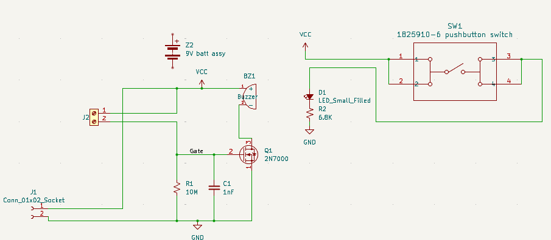
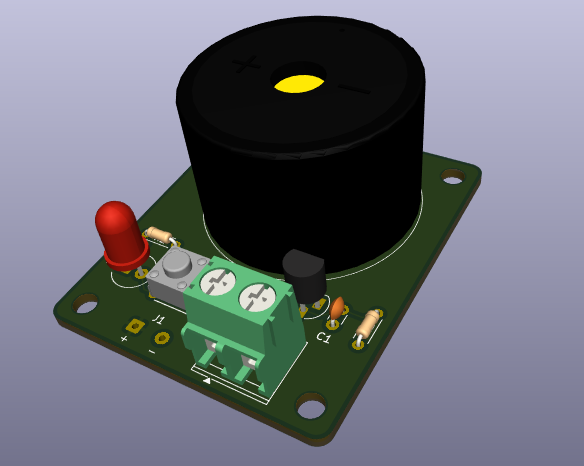
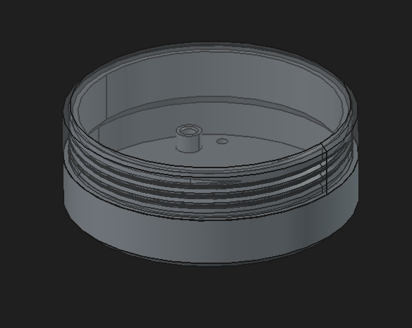

# Water Alarm

## Overview

This project was created to learn the fundamentals of PCB design using KiCad, develop mechanical CAD skills in FreeCAD by designing a 3D-printed enclosure, and build a practical, functional device.

The project was inspired by the [KiCad course by DigiKey on YouTube](https://www.youtube.com/watch?v=0WCi1rhueH4&list=PLEBQazB0HUyQ5YJSdCBb79orXaR3Uk5vm), with some modifications to the original circuit.

## Components

- [Buzzer](https://www.digikey.ca/en/products/detail/pui-audio-inc/AI-3035-TT-12V-R/9083403)
- [MOSFET](https://www.digikey.ca/en/products/detail/diotec-semiconductor/2N7000/13164314)
- [Screw terminal](https://www.digikey.ca/en/products/detail/adam-tech/EBAA-02-C/13586872)
- [LED](https://www.digikey.ca/en/products/detail/liteon/LTL-4234/200373)
- [10 MΩ resistor](https://www.digikey.ca/en/products/detail/stackpole-electronics-inc/CF18JT10M0/1741568)
- [6.8 kΩ resistor](https://www.digikey.ca/en/products/detail/stackpole-electronics-inc/CF18JT6K80/1741748)
- [1 nF capacitor](https://www.digikey.ca/en/products/detail/vishay-beyschlag-draloric-bc-components/K102K10X7RH5UL2/2820341)
- [Tactile switch](https://www.digikey.ca/en/products/detail/te-connectivity-alcoswitch-switches/1825910-6/1632536)
- [9 V battery](https://www.digikey.ca/en/products/detail/panasonic-energy/6LF22XWA-B/5067196)
- [Heat-set inserts](https://www.digikey.ca/en/products/detail/adafruit-industries-llc/4255/10244656)
- [M3 screws](https://www.digikey.ca/en/products/detail/w%C3%BCrth-elektronik/97790603111/10056387)

## Tools Used

- KiCad (schematic capture and PCB layout)
- FreeCAD (enclosure design)
- GitHub (version control and documentation)

## What I Learned

- Creating schematics in KiCad
- PCB component placement
- Trace routing and board layout
- Designing and 3D-printing an enclosure to fit a custom PCB

## Images

### Schematic

### PCB Layout

### 3D PCB View

### Enclosure

### Assembled PCB

### Assembled Device